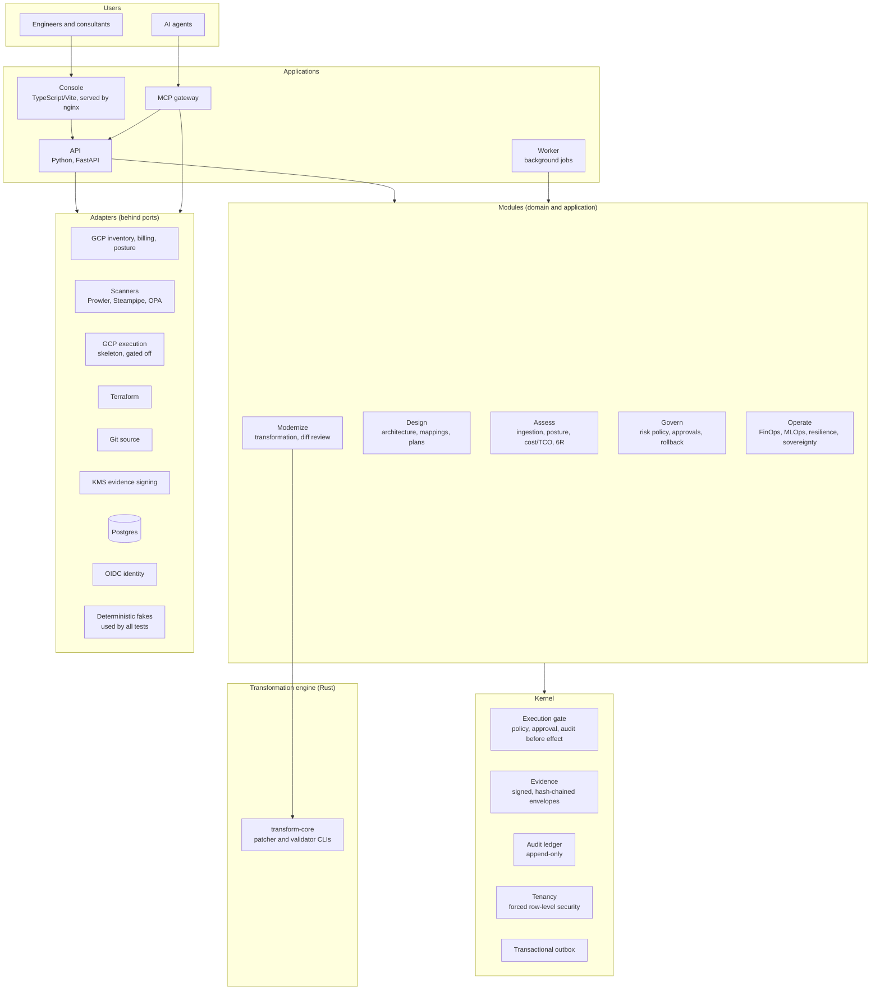

# CAIRN

CAIRN is an open-source cloud modernization platform. It assesses an estate, applies 6R dispositions, designs a target architecture, modernizes code and infrastructure, and records every governed step as signed, verifiable evidence.

It is for platform and cloud engineering teams running a migration or modernization programme, and for consultancies building that capability for clients, who want each stage to produce auditable evidence rather than slide decks and one-off scripts.

> **Status (v0.5.0):** R0 to R3 and R5 are complete. R4 (govern) is partially built. Every cloud-provider adapter has been exercised only against deterministic fakes or one synthetic estate; the clean-room transformation engine and the rest of the system are real, tested code, just never pointed at a customer's actual cloud account. **No code in this repository has executed a write against a real cloud account.** Do not point it at a production environment.

## What CAIRN does

| Stage | Capability | Status |
|---|---|---|
| **Kernel** (R0) | Domain model, provider ports, signed evidence, append-only audit ledger, multi-tenant isolation, conformance rules | Complete |
| **Assess** (R1) | Estate ingestion, posture checks against a control catalogue, cost/TCO baselines, 6R classification, signed evidence packages | Complete |
| **Design** (R2) | Target architecture, equivalence mappings, migration plans, pattern library, diagram and plan export | Complete |
| **Modernize** (R3) | Clean-room transformation of Terraform and Python, with diff review and static validation | Complete |
| **Govern** (R4) | Risk-tier policy engine, approval console, execution contract, Terraform plan orchestration, rollback and compensation engine | Partial: built and tested against a fake adapter; real-cloud proofs not started |
| **Operate** (R5) | FinOps, LLMOps, MLOps, resilience and sovereignty loops, MCP and A2A surfaces, a first vertical pack (UK public sector) | Complete against fake adapters and a synthetic estate |

CAIRN is read-only or workspace-only against customer environments through R3, with no write or execute credential ever requested or stored. Two production-capable provider adapters exist for GCP: a real read-only inventory adapter (R1), tested only against a fake HTTP client and never pointed at a real account, and a write/execute adapter (R4), structure only with no cloud SDK import or network call anywhere in its own code path, deliberately unreachable through the execution gate until a real project, IAM bindings and approvals are in place.

## Architecture at a glance

CAIRN is hexagonal: the domain never talks to a cloud SDK directly. Everything crosses a port, and an adapter sits on the other side.



| Layer | What lives there | Where in the repo |
|---|---|---|
| Applications | API, worker, console, MCP gateway | `apps/` |
| Modules | Assess, design, modernize, govern and operate logic | `packages/modules/` |
| Kernel | Execution gate, evidence, audit, tenancy, outbox, conformance | `packages/kernel/` |
| Contracts | Shared schemas for estate, posture, mapping, FinOps, transformation, events | `packages/contracts/` |
| Kits | MCP and A2A surfaces, operate loops, vertical packs | `packages/kits/` |
| Transformation engine | Rust patcher and validator | `packages/transform-core/` |
| Adapters | GCP, scanners, Terraform, Git, Postgres, KMS, OIDC, diagram export, fakes | `packages/adapters/` |
| Infrastructure | Terraform modules (network, IAM, data, runtime, evidence, observability), Helm chart | `infra/` |

Key decisions:

- **Hexagonal/DDD, enforced in CI** (ADR-002). `import-linter` fails the build if domain code imports a provider SDK.
- **Python 3.12** for domain and application code; **Rust** for the transformation engine (ADR-006).
- **Multi-tenant Postgres** with forced row-level security and signed tenant-context assertions (ADR-007, ADR-012).
- **Signed, hash-chained evidence** for every governed action, verifiable offline (ADR-008).
- **Gated writes** (ADR-010): any change to a customer environment must pass policy, approval and audit before it happens.
- **GCP-first** (ADR-005), with a UK jurisdiction pack as the first launch target (ADR-016). AWS and Azure adapters are placeholders today.
- **OpenID Connect** for identity, bring your own provider. See [Identity and sign-in](docs/identity.md).

See the [architecture decision records](docs/adr/README.md) and the [technical implementation specification](CAIRN-TECHNICAL-IMPLEMENTATION-SPEC.md) for detail.

## Quickstart

Requires Docker and Docker Compose.

```
docker compose up --build
```

This starts:

- the **API** on `http://localhost:8080` (`GET /healthz`, `GET /readyz`)
- the **worker** on `http://localhost:8081`
- the **console** on `http://localhost:3000`
- a local **dex** identity provider, so you can sign in with no setup

Open `http://localhost:3000` and sign in with the bundled demo identity. You can create a project, upload an estate, run an assessment, and see posture, cost/TCO and 6R results.

The quickstart keeps all data in memory, so nothing survives a restart, and the demo identity has broader roles than a real deployment would grant. It is a local convenience, not a deployment. See `docs/identity.md` to use your own OIDC provider.

## Development

Requires Python 3.12, [uv](https://docs.astral.sh/uv/), Rust/Cargo and [pnpm](https://pnpm.io/). Postgres is optional: a few integration tests skip without `CAIRN_TEST_DATABASE_URL`.

```
make bootstrap   # uv sync, cargo fetch, pnpm install
make test        # builds the Rust CLIs in release mode, then runs the Python and Rust suites
make lint        # ruff, import-linter, cargo fmt/clippy, pnpm lint
make conformance # conformance rule set
```

`make test` runs the same sequence as CI, so a green local run means CI will pass the same gate.

## Roadmap

| Release | Scope | Status |
|---|---|---|
| **R0** | Kernel, tenancy, evidence, audit, observability, conformance | Complete |
| **R1** | Estate ingestion, posture, cost/TCO, 6R, assessment console, evidence packages | Complete |
| **R2** | Target architecture, equivalence mapping, migration plans | Complete |
| **R3** | Clean-room transformation engine (Terraform and Python first) | Complete |
| **R4** | Execution gate and governed customer-environment writes | Partial: policy, approvals, plan orchestration and rollback built against a fake adapter; real-cloud read, write and rollback proofs need a real GCP project and have not started |
| **R5** | Operate loops, MCP/A2A surfaces, vertical packs | Complete against fake adapters and a synthetic estate |
| **Next** | Real-cloud R4 proofs on GCP, then AWS and Azure adapters | Planned |

## Documents

| Document | Purpose |
|---|---|
| [Technical implementation specification](CAIRN-TECHNICAL-IMPLEMENTATION-SPEC.md) | Contracts, schemas, deployment and backlog |
| [Architecture patterns](CLOUD-ARCHITECTURE-PATTERNS.md) | Design patterns; nothing is reused as code |
| [Architecture decision records](docs/adr/README.md) | ADR-001 to ADR-018 |
| [Reference register](docs/specs/reference-register.md) | Clean-room evidence log |
| [Identity and sign-in](docs/identity.md) | OIDC, local dex, bring your own IdP |
| [Third-party licences](docs/third-party-licenses.md) | Dependency licences |
| [Changelog](CHANGELOG.md) | What shipped in each release |

## Licence

Apache-2.0. See [LICENSE](LICENSE) and [NOTICE](NOTICE). There is no open-core gate. Professional services are available separately from [Solara Associates](https://solara.associates).

## Contributing

See [CONTRIBUTING.md](CONTRIBUTING.md). Contributions use the Developer Certificate of Origin, and the clean-room policy is strict: no code, assets or configuration from the repositories listed in the reference register. See also [CODE_OF_CONDUCT.md](CODE_OF_CONDUCT.md) and [GOVERNANCE.md](GOVERNANCE.md).

## Security

See [SECURITY.md](SECURITY.md). Report vulnerabilities through GitHub's private security advisories, not public issues. There is no support or warranty promise without a separate engagement.
